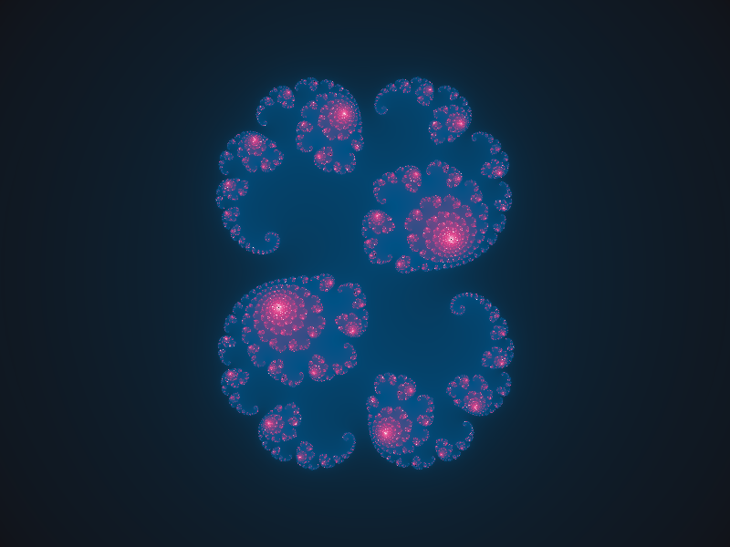
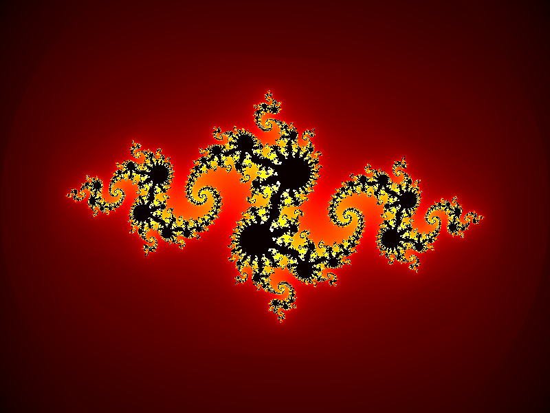
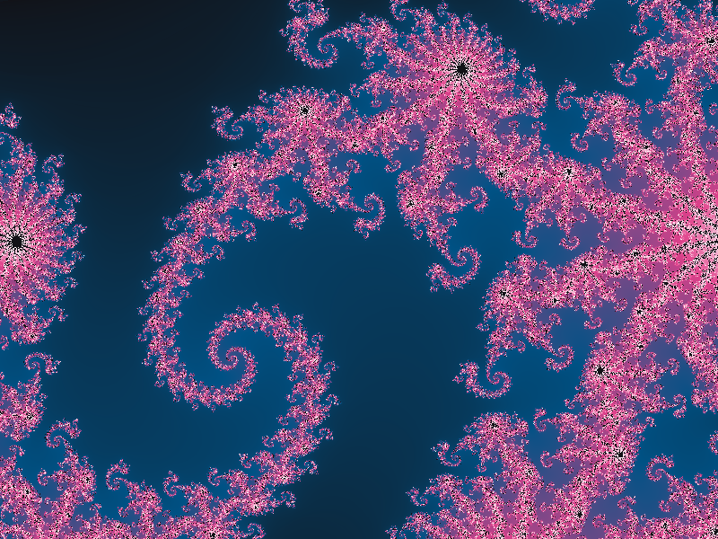
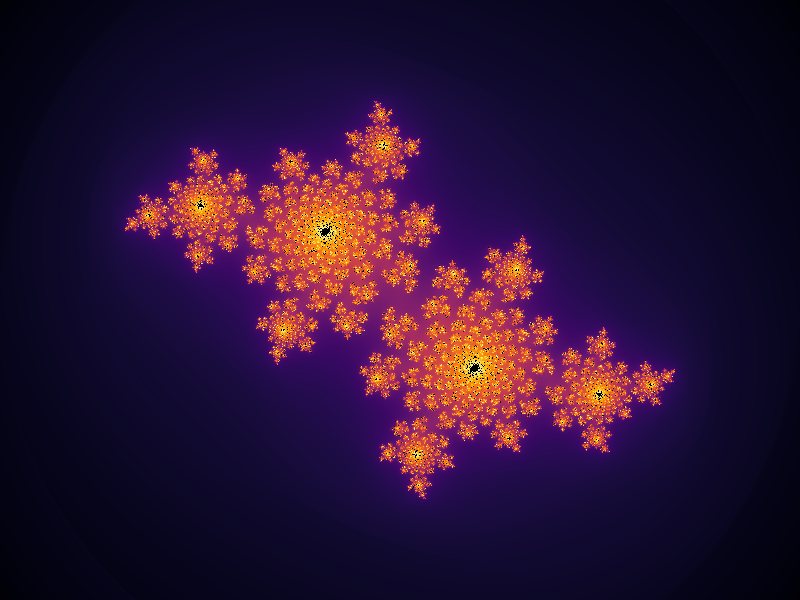

<div align="center">
  
</div>

# Julia-Set-Gen

<div align="center">
  
</div>

Julia-Set-Gen draws Julia sets: fractals that are close cousins of the Mandelbrot set.

**How it works.** Every pixel is a point *z* on the complex plane. The program applies *f(z) = z² + c* to it over and over. Some points stay close to the middle forever: those are the Julia set, drawn in the darkest colour. Others fly off to infinity: those are coloured by how many steps it took them to leave the circle |z| ≤ 2, smoothed so the colours blend instead of forming bands. Each value of the constant *c* gives a different shape.

**What you can change** (from the command line): the constant `c`, the colour palette, the zoom and centre, the maximum number of iterations, the image size and the output file. The result is saved as a PNG.

| `--c=-0.8+0.156im` (default, `hot`) | `--zoom=4 --center=-0.35,0.2` (`cursed`) |
| --- | --- |
|  |  |
| `--c=-0.4+0.6im --palette=inferno` | `--c=0.285+0.01im --palette=cursed` |
|  |  |

## How to run

You need [Julia](https://julialang.org/downloads/) 1.6 or newer.

```bash
julia --project=. -e "using Pkg; Pkg.instantiate()"     # once: installs ColorSchemes and PNGFiles
julia --project=. -t auto Main.jl                       # writes julia.png
```

Options (all optional):

| Option | Default | What it does |
| --- | --- | --- |
| `--c=` | `-0.8+0.156im` | The constant c in z² + c |
| `--palette=` | `hot` | Any [ColorSchemes](https://juliagraphics.github.io/ColorSchemes.jl/stable/catalogue/) name (`inferno`, `viridis`, ...) or `cursed` |
| `--zoom=` | `1` | 1 shows x from -2 to 2; 4 is four times closer |
| `--center=` | `0,0` | The point the view is centred on |
| `--iter=` | `100` | Maximum iterations: more shows finer detail and takes longer |
| `--size=` | `800x600` | Image size in pixels |
| `--out=` | `julia.png` | The PNG to write |

Example: `julia --project=. -t auto Main.jl --c=0.285+0.01im --palette=cursed --iter=300 --out=cursed.png`

`-t auto` lets Julia use every CPU core; the image is computed column by column in parallel.

## License

MIT, see [LICENSE](LICENSE).

<br>
<div align="center">
© Cursed Entertainment 2026
</div>
<br>
<div align="center">
<a href="https://cursed-entertainment.itch.io/" target="_blank">
    
</a>
</div>
